
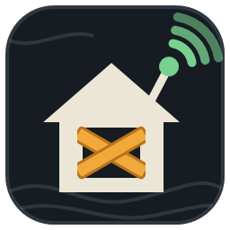

<h1 align="center">Knox Safehouse</h1>

<b>Your Project Zomboid server for friends, on the air in minutes.</b> 
A free Windows app that installs and runs a Project Zomboid dedicated server: Workshop mods in the right order, firewall and an invite for your friends — no command lines.

  <a href="https://safehouse-works.pages.dev"><b>Website</b></a> ·
  <a href="https://github.com/PzLauncher/knox-safehouse/releases"><b>Download</b></a> ·
  <a href="#-português">Português</a>

> Unofficial fan project, not affiliated with or endorsed by The Indie Stone. Project Zomboid belongs to its owners. Non-commercial.

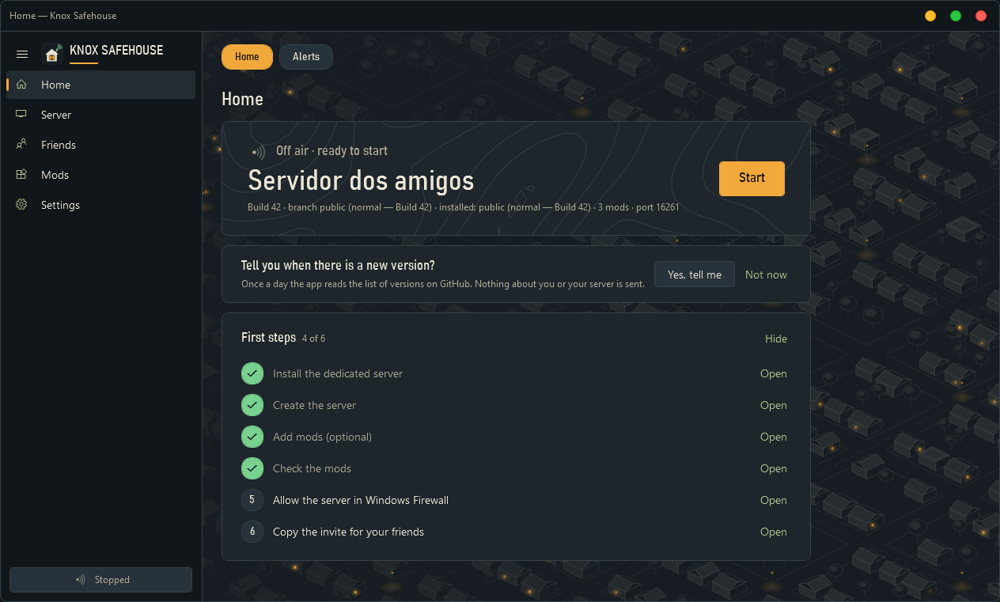

## 🔜 Coming soon: version 1.1
The screenshots below already show 1.1. The download is still **1.0** until 1.1 is out.
- **Smoother everywhere:** the side menu slides away slowly, pages fade in, rounded window corners and colourful window buttons.
- **New living backgrounds** in the style of Project Zomboid's map, and **My theme** to pick your own colour and picture.
- **Sign in to Steam inside the app** with a QR code, and **invite friends from Discord**.
- **Create server:** choose the RAM, disk and number of players; passwords are required.
- **Check the server** after creating it, and fix most problems with one click.
- A proper install folder, a clear update window, and an uninstall where you choose what to delete.

## What it does
- **The server in one click** — installs and updates the official dedicated server with SteamCMD (Valve's signature checked), start/stop/restart, a console with filters and command history, a daily restart that warns the players and copies the world.
- **Mods in the right order** — add from the Workshop inside the app, paste links or a whole collection: Workshop IDs ↔ Mod IDs, the items a mod needs on the Workshop are downloaded too and their dependencies added automatically, drag to reorder, warnings when something is out of place, alerts for outdated or removed mods.
- **Friends inside** — Windows Firewall rule (UDP, server ports only, the networks you choose), router steps, an invite ready for Discord, and modpack codes so friends can check they have the same mods.
- **Your players** — see who is on, kick, ban, unban or make someone admin with a button.
- **Go back when it breaks** — every change to the mod list is kept; restore the last list that worked. **World copies** in one click (and before each daily restart), put any copy back — the current world is copied first.
- **Keeps watch** — warns when Steam updates the game (before friends can't join), restarts the server if it crashes (up to 3 tries), and can tell you when a new version of the app is out.
- **Private by default** — passwords in Windows Credential Manager, `UPnP=false`, RCON off, no telemetry.
- **Leaves no trace** — per-user install (no administrator) or portable mode; the uninstaller removes exactly what the app created.
- **Five themes with a living background** — Night in Knox, Paper map, Riverside forest, West Point rust and Winter in Knox: radio pulses, a pencil route, fireflies, a train, falling snow (off with Windows' animations). Same contrast in all of them.
- Portuguese (Portugal), Brazilian Portuguese and English · keyboard and screen-reader friendly.

| Server | Players | World copies |
|---|---|---|
| 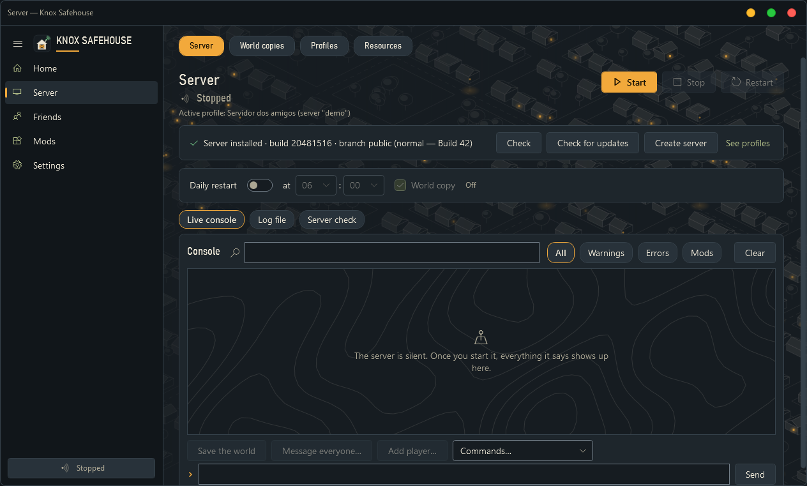 | 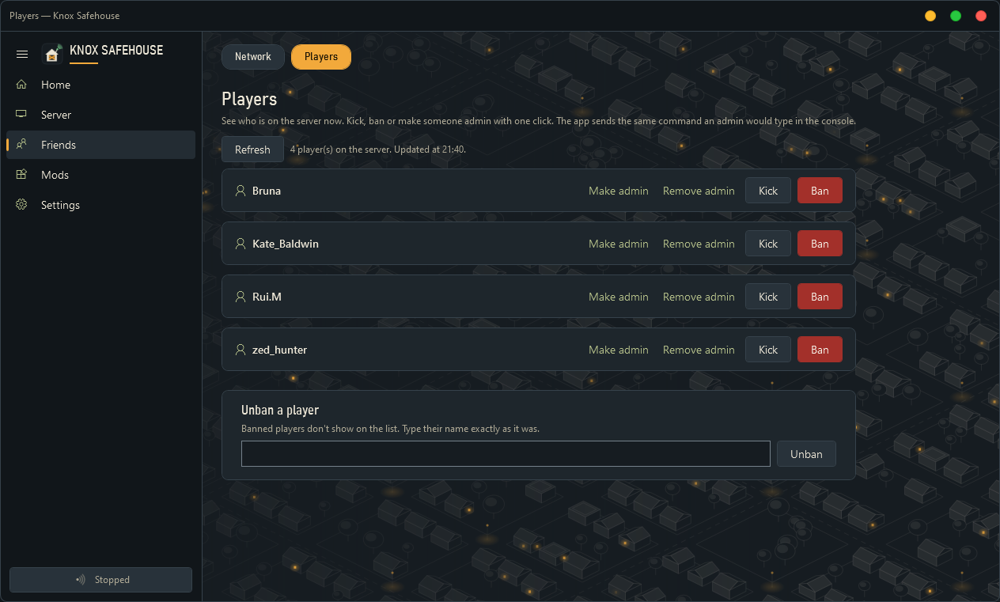 | 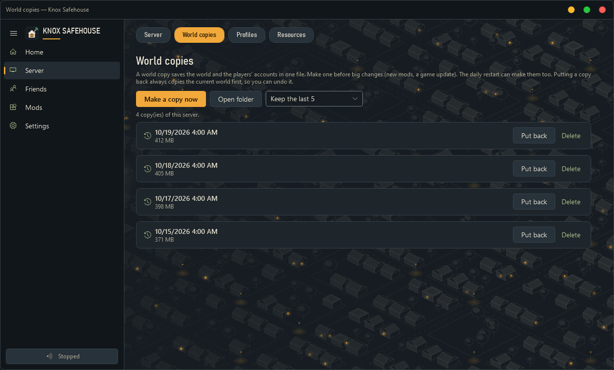 |

| Mods | Profiles |
|---|---|
| 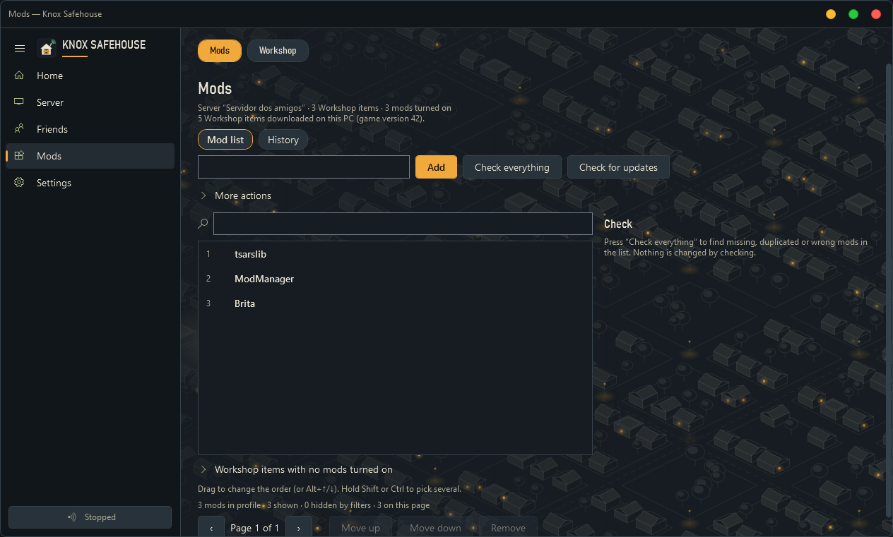 | 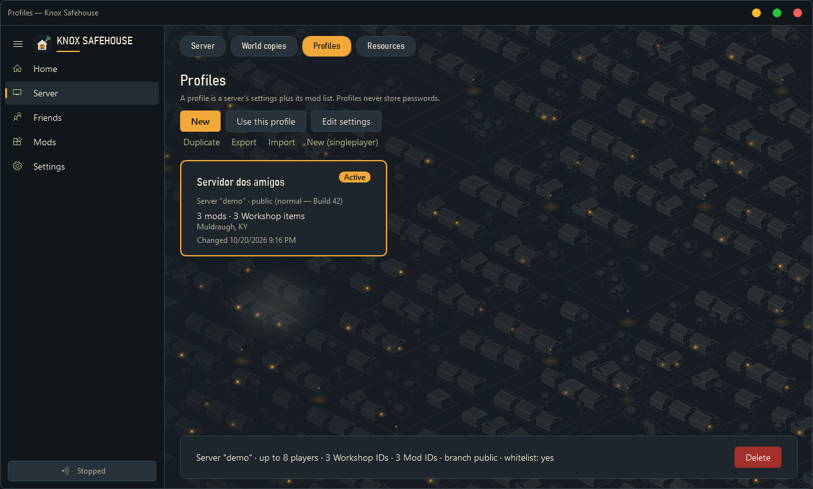 |

### Themes
| Paper map | Riverside forest | West Point rust | Winter in Knox |
|---|---|---|---|
| 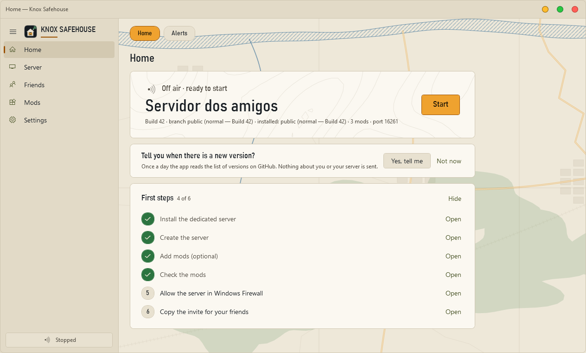 | 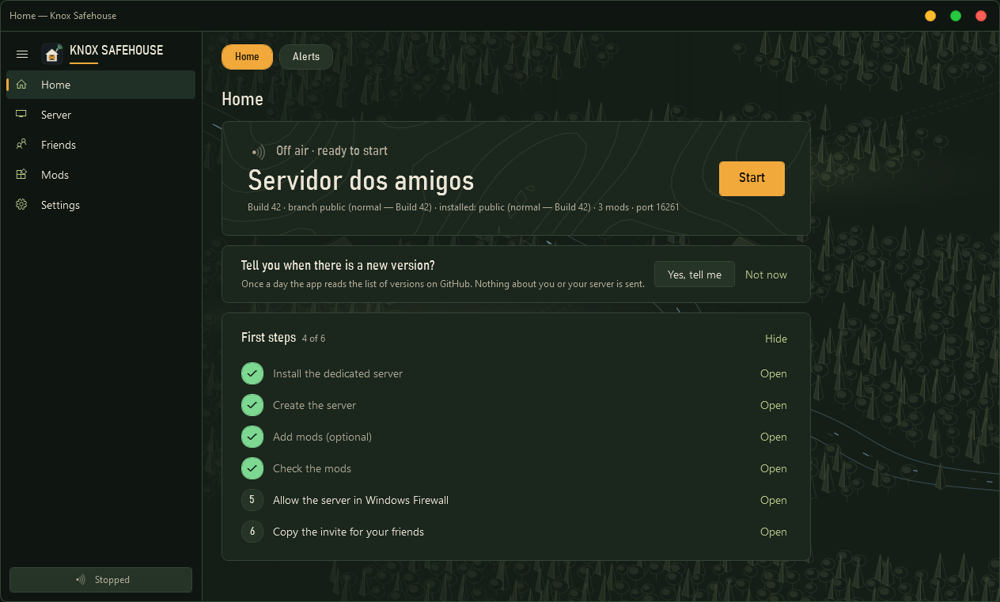 | 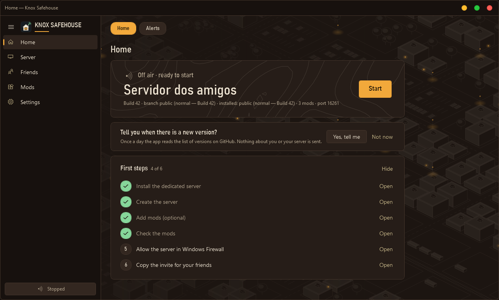 | 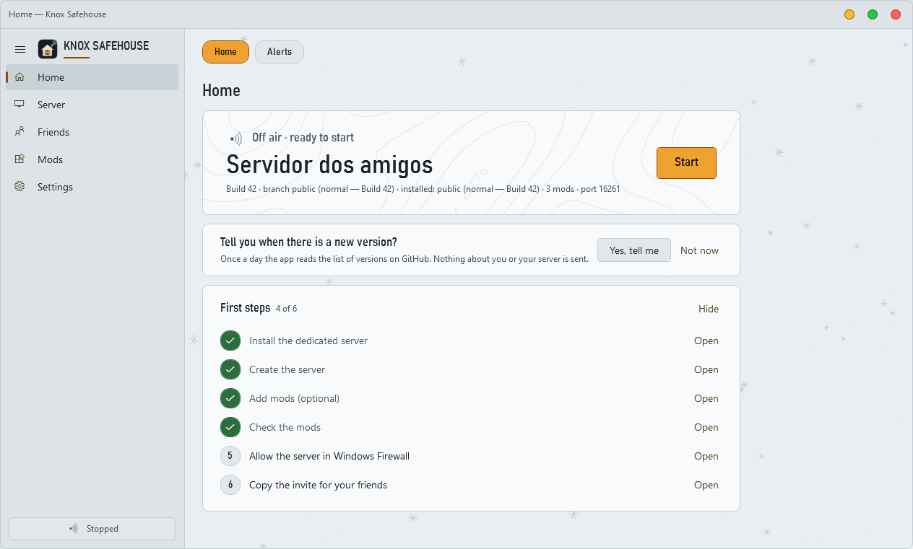 |

## Download
Get the latest **`KnoxSafehouse-<version>-win-x64.zip`** from [Releases](https://github.com/PzLauncher/knox-safehouse/releases). It contains `KnoxSafehouse.exe` (self-contained, no .NET install needed), its SHA-256, `LEIA-ME.txt` and `SECURITY.md`.

- **Requirements:** Windows 10 or 11, 64-bit. The in-app Workshop uses Microsoft Edge WebView2 (already on almost every PC; the app links to Microsoft's page if it is missing).
- **Check the file:** `Get-FileHash .\KnoxSafehouse.exe -Algorithm SHA256` must match the hash in the release notes and in [SECURITY.md](SECURITY.md).
- **SmartScreen:** builds are not code-signed yet, so Windows may warn — *More info → Run anyway*.

## About
This repository holds the **public releases** of Knox Safehouse. The source code is kept private for now.

Made by **Safehouse Works**:
- **PzLauncher** — creator: the idea, the decisions and the testing on real hardware.
- **Claude** — AI collaborator (Anthropic's assistant): helped write and review the code and design the app and the website, with the creator making the final calls. Anthropic is not affiliated with or endorsing this project.

Thanks to The Indie Stone for creating Project Zomboid (https://projectzomboid.com/), which made this possible. This is an unofficial fan production for non-commercial purposes made under the Indie Stone Terms.

Licence: all rights reserved — free to download and use, no warranty.

---

## 🇵🇹 Português

> 🔜 **A versão 1.1 vem em breve:** animações mais suaves, fundos novos e «O meu tema», login da Steam com código QR, convites pelo Discord, escolher a RAM/disco/jogadores do servidor e «Verificar o servidor». As imagens já mostram a 1.1; o download continua a ser a 1.0 até ela sair.

**O teu servidor de Project Zomboid para os amigos, no ar em minutos.** App gratuita para Windows 10/11 que instala e gere um servidor dedicado: mods do Workshop pela ordem certa, firewall e convite para os amigos, sem linhas de comando.

Ao juntar um mod, a app também descarrega os **itens de que ele precisa no Workshop** e põe os Mod IDs por ordem no `.ini`. Também: lista de **jogadores** (expulsar, banir, dar admin), **cópias do mundo** com um clique (e repor qualquer uma), aviso quando a Steam **atualiza o jogo**, **reinício automático** se o servidor falhar e **cinco temas** com fundo animado.

> Projeto de fãs, não oficial, sem ligação à The Indie Stone. Project Zomboid pertence aos respetivos donos. Não comercial.

- **Site:** https://safehouse-works.pages.dev
- **Descarregar:** em [Releases](https://github.com/PzLauncher/knox-safehouse/releases), o ficheiro `KnoxSafehouse-<versão>-win-x64.zip`. Confirma o SHA-256 (está nas notas da versão e no [SECURITY.md](SECURITY.md)) e segue o `LEIA-ME.txt`.
- **Aviso azul do Windows (SmartScreen):** a app ainda não tem assinatura digital — *Mais informações › Executar mesmo assim*.

Feito pela **Safehouse Works**: **PzLauncher** (criador) com a ajuda do **Claude**, assistente de IA da Anthropic (a Anthropic não está ligada ao projeto).
